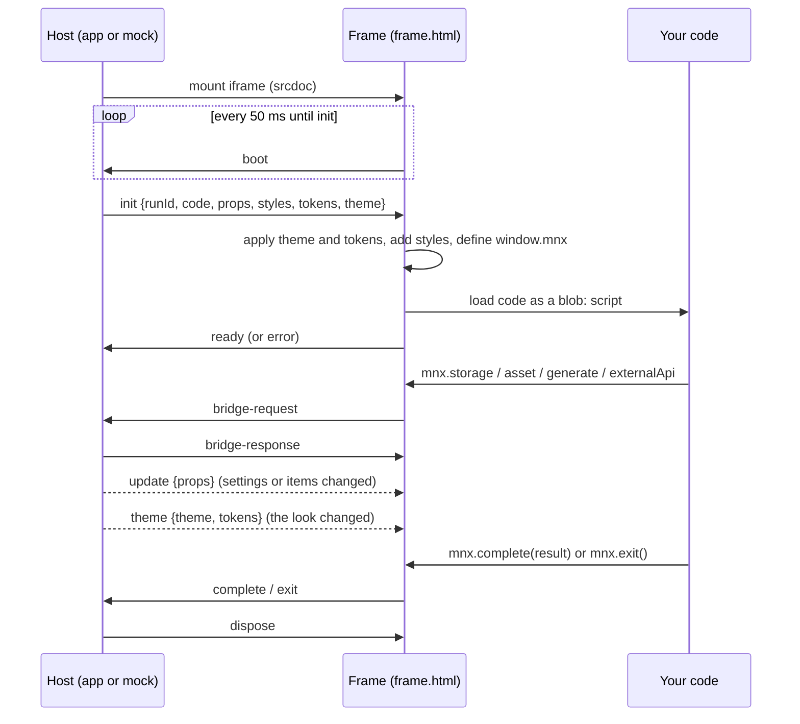

# The add-on guide

This guide explains how MnemoNexus add-ons work and how to build one with this
kit. It follows [`docs/HOST_CONTRACT.md`](docs/HOST_CONTRACT.md), which is the
exact statement of what the app does. When the two differ, the contract wins.
Where the contract is silent, see [`docs/HOST_GAPS.md`](docs/HOST_GAPS.md).

**Contents**

1. [Words used here](#1-words-used-here)
2. [Add-on kinds](#2-add-on-kinds)
3. [Surfaces: where an add-on appears](#3-surfaces-where-an-add-on-appears)
4. [Permissions, and why each exists](#4-permissions-and-why-each-exists)
5. [The sandbox, and what it stops](#5-the-sandbox-and-what-it-stops)
6. [The lifecycle of a run](#6-the-lifecycle-of-a-run)
7. [Props and results](#7-props-and-results)
8. [Study mode in depth](#8-study-mode-in-depth)
9. [Styling and theme v1](#9-styling-and-theme-v1)
10. [The UI library](#10-the-ui-library)
11. [Assets](#11-assets)
12. [AI](#12-ai)
13. [Storage](#13-storage)
14. [Settings](#14-settings)
15. [Learning add-ons](#15-learning-add-ons)
16. [Testing with the mock host](#16-testing-with-the-mock-host)
17. [Checking](#17-checking)
18. [Packing and installing](#18-packing-and-installing)
19. [Publishing](#19-publishing)
20. [Porting a project](#20-porting-a-project)

---

## 1. Words used here

- **Host:** the MnemoNexus app, which loads and runs your add-on.
- **Add-on:** your code plus a manifest, shipped as a `.mnxpack` file.
- **Manifest:** `manifest.json` in your add-on folder. It says what the add-on
  is, where it can appear and what it may do. In the pack it becomes `pack.json`.
- **Frame:** the `<iframe>` the host puts your add-on in.
- **Sandbox:** the browser rules that lock that frame down.
- **Bridge:** the small set of requests your add-on can make to the host
  (read an asset, store a value, call a model, call a data source).
- **Props:** what the host tells your add-on about this run.
- **Surface:** a place in the app where an add-on can be launched.
- **Scenario:** a JSON file that describes one launch, for the mock host.
- **Learning add-on:** an experience with a `learning` contribution. The app
  asks it to prepare tasks from the lecture the user is reading, then places a
  task in the study session (section 15).
- **Theme:** the user's look (colours, corners, edges, fonts, motion), handed to
  the add-on as `--mnx-*` tokens (section 9).

## 2. Add-on kinds

The manifest's `kind` says what sort of add-on it is.

| Kind | What it is |
|---|---|
| `experience` | A launchable activity: a quiz, a simulation, an exercise. **Most add-ons are this, and this kit is built for it.** |
| `recall-face` | A different face for recall (spaced repetition) cards. |
| `index-view` | A long-lived view over the Knowledge Index (the user's knowledge base). |
| `knowledge-set` | A set of knowledge, as data. |
| `automation-template` | A template for an automation. Data only: no code view, no permissions. |

The mock host runs experiences. `bun run check` validates the manifest of any
kind but only runs experiences.

## 3. Surfaces: where an add-on appears

An experience can be launched from several places. Each one is a **surface**.
You opt in to a surface by declaring it under `surfaces` in the manifest.

| Surface | Where | Declare | What you must do |
|---|---|---|---|
| `standalone` | Opened from the Experiences page. Every experience can be. | Nothing. | Work from `props.items`, or bring your own content. |
| `study` | Inside a study session, next to a lecture subsection. | `surfaces.study` with reviewed tasks. | Return `studyEvidence` that matches `props.study`. |
| `recall` | A recall (review) session. | `surfaces.recall`, plus `schedule:recall`. | Return `quality`, a whole number 0-5. |
| `transferal` | Applying knowledge in a new setting. | `surfaces.transferal`, plus a `consumes` or `transforms` binding. | Work with the items you are given. |
| `calendar` | A scheduled block in the user's calendar. | `surfaces.calendar`, plus `schedule:calendar`. | Fit the session length you declare. |

Only an `experience` may declare `recall`, `transferal`, `calendar` or `study`.

## 4. Permissions, and why each exists

Permissions are listed in the manifest. The app enforces them: a request your
add-on has no permission for is refused. The checker also makes sure your
permissions match what your manifest does, in both directions. Asking for a
permission you do not use is an error, not a harmless extra.

| Permission | Lets the add-on… | Why it is a permission |
|---|---|---|
| `knowledge:read` | Receive knowledge items, and a learning add-on's source. Required with a `consumes` or `transforms` binding or a `learning` contribution, and not allowed without one of them. | The user's notes are private. They only flow to add-ons that say they read them. |
| `knowledge:unlock-authored` | Unlock knowledge from its `producedKnowledge` table. | Changes the user's knowledge base. |
| `knowledge:propose` | Propose new knowledge in a result. Needs a `produces` or `transforms` binding. | Same. |
| `ai:generate` | Call `mnx.generate` on the user's local model. | Model calls cost the user time and battery. |
| `schedule:recall` | Appear on the recall surface and set the next review. | Changes the user's review schedule. |
| `schedule:calendar` | Appear on the calendar surface. | Puts time in the user's calendar. |
| `network` | Reach `https:` from the frame, and call your declared data sources through `mnx.externalApi`. | Without it, nothing leaves the frame. |
| `multiplayer` | Multiplayer features. | Involves other people. |
| `render:3d` | Use a 3D engine, declared in `engines.three`. | Heavy on the user's machine. |
| `storage:local` | Use `mnx.storage`. | Keeps data on the user's machine. |

The **knowledge binding** says how the add-on relates to the user's knowledge:

| Binding | Meaning |
|---|---|
| `{"mode": "none"}` | Does not use the user's knowledge. |
| `{"mode": "produces"}` | Can add knowledge (unlocks or proposals). |
| `{"mode": "consumes", "compatRule": …}` | Reads knowledge items picked by the `compatRule`. |
| `{"mode": "transforms", "compatRule": …}` | Reads and adds. |

A **compatRule** is a small tree of tests that decides which knowledge items
your add-on is given. Every node has a `whenTrue` and a `whenFalse` reason,
which the app shows to the user. For example, "items with at least 20
characters of text":

```json
{ "kind": "minTextLength", "value": 20,
  "whenTrue": "The item has enough text to ask about.",
  "whenFalse": "The item is too short to ask about." }
```

Every node names its test in `kind`. The tests:

| `kind` | Passes when |
|---|---|
| `always` | Always. |
| `hasConcept` | The item has a `conceptId`. |
| `minTextLength {value}` | The trimmed `text` is at least `value` characters. |
| `minStructuredItems {value}` | `structuredItems` has at least `value` entries. |
| `hasMedia {value}` | `hasMedia` equals `value`. |
| `descriptorTypeIn`, `descriptorStructureIn`, `conceptKindIn`, `disciplineIn`, `practiceModeIn`, `tagIn` `{values}` | Any of the item's values is in `values`. |
| `allOf {rules}` | Every child passes (it reports the first failure). |
| `anyOf {rules}` | Any child passes (it reports the first pass). |
| `not {rule}` | Its child fails. |

An unknown `kind`, or a tree deeper than 10 levels, matches nothing.

**Which items you get:** the host runs your rule over the candidate items on
every surface. A `none` or `produces` binding always gets `[]`. If you declare
`surfaces.transferal.maxItems`, you get at most that many on every surface.
Study launches get the current subsection's compatible items (section 8).

## 5. The sandbox, and what it stops

The app mounts every add-on like this:

```html
<iframe sandbox="allow-scripts" referrerpolicy="no-referrer" srcdoc="…reference/frame.html…">
```

`reference/frame.html` is the exact document the app loads. It includes a
**Content Security Policy** (CSP), a list of what the page may load. Together
they stop a lot:

| You cannot… | Because… | Do this instead |
|---|---|---|
| Read or change the app's page | The frame has an **opaque origin**: it counts as a stranger to everything. | Talk to the host through `window.mnx`. |
| Use `localStorage`, `sessionStorage` or IndexedDB | They **throw** `SecurityError` with an opaque origin. | `mnx.storage` (needs `storage:local`). For a library that expects them, see [section 20](#20-porting-a-project). |
| Use `eval` or `new Function` | The CSP has no `unsafe-eval`. | Plain code. Avoid libraries that compile code at runtime. |
| Compile WebAssembly | The CSP has no `'wasm-unsafe-eval'`. | A plain JavaScript build of the library, or leave out the feature that needs it. |
| Use `fetch`, `XMLHttpRequest`, `WebSocket` or `EventSource` | `connect-src 'none'` unless you have `network`. | Ship data as assets, or use `mnx.externalApi`. |
| Load remote images, fonts or stylesheets | Images only from `data:` and `blob:`; fonts only from `data:`. The app's own fonts are not in the frame. | Bundle CSS in your code, embed fonts as `data:` URLs, or use system fonts. Load images with `mnx.asset()`. |
| Open popups, nested frames, plugins, submit forms, or download files | The sandbox and CSP forbid them. | Draw everything in `mnx.root`. |
| Load more than one script | The code file is loaded once, as a plain script, with no module loader or `require`. | Bundle everything into one IIFE (the kit does this). |

The frame is **transparent**: the app's own surface shows through, so don't
paint `body` unless you need a solid backdrop (a canvas, say).

The frame fills its slot: `html`, `body` and `#root` are 100% high. Draw into
`mnx.root`.

**Which browser?** On Windows, add-ons run in Microsoft Edge WebView2, which
is Chromium and keeps itself up to date; a macOS build would use Safari's
engine. Build for Chromium 111 or Safari 16.4 and later (contract section 2).
`color-mix()`, `:has()`, `@property` and cascade layers are all safe.

**Why so strict?** Add-ons come from anyone. The sandbox means a broken or
hostile add-on can only spoil its own frame: it cannot read the user's notes
unless they were given to it, or send them anywhere.

`bun run check` scans your bundle for each of these and explains what to do.

## 6. The lifecycle of a run



Things to know:

- **Every run has its own `runId`.** The host ignores messages for any other run.
- **Any `error` fails the run, for good.** An uncaught exception or an unhandled
  promise rejection is posted to the host, which shows a failure screen. Catch
  what you can recover from.
- **`complete` and `exit` both end the run** from the user's point of view.
  `complete` hands back a result; `exit` leaves without one. Only the first
  `complete` counts. The app then closes the frame (on study, straight away), so
  don't rely on a "done" screen being seen.
- **`dispose`** empties `#root` and rejects any pending bridge calls with
  `Error('The add-on was closed.')`.
- **`update`** swaps `mnx.props` mid-run and calls your `onUpdate` handler. The
  host sends it whenever the props change while you run: when the user changes
  one of your settings, or when the launching surface re-renders with a new
  item list. Handle it, or ignore it safely (with no handler, nothing happens).
- **`theme`** arrives when the user's look changes while you run. The frame
  applies the new tokens in place, so CSS that reads them just follows. Nothing
  is remounted. `mnx.onTheme(fn)` is called afterwards (section 9).

Start your code with `getExperienceHost()`. It returns `window.mnx` after
checking the launch is one an experience can handle:

```ts
import { getExperienceHost } from '@mnemonexus/addon-sdk';
const mnx = getExperienceHost();
```

## 7. Props and results

`mnx.props` tells you about this run:

```ts
{
  kind: 'experience',
  extensionId: string,                 // your manifest id
  surface: 'standalone' | 'recall' | 'transferal' | 'calendar' | 'study',
  items: KnowledgeItem[],              // already filtered by your compatRule
  permissions: Permission[],           // everything your manifest declared
  study?: StudyExperienceContext,      // only on the study surface
}
```

A **knowledge item** is one fact from the user's notes: a concept
(`conceptTitle`, `conceptKind`), what kind of statement it is
(`descriptorType`, such as `definition` or `mechanism_step`), its `text`, and
for lists and sequences the `structuredItems`. The vocabularies can grow, so
handle values you do not know: never guess what a new one means.

When the user finishes, call `mnx.complete(result)`:

```ts
{
  completed: boolean,
  elapsedSeconds: number,
  quality?: number,                // 0-5 whole number; REQUIRED on recall
  completedStages?: string[],      // drives producedKnowledge unlocks
  itemCoverage?: Record<lineageId, number>,  // 0-1, keyed by lineageId (not itemId)
  proposedKnowledge?: [...],       // needs knowledge:propose
  studyEvidence?: {...},           // REQUIRED on study (next section)
}
```

What happens to it depends on the surface. On study, the host checks it
strictly (next section). Elsewhere the host does not check its shape: it hands
it to the surface. Recall reads `quality`; only `completed: true` counts as a
use; `completedStages` unlock your `producedKnowledge` (with
`knowledge:unlock-authored`); `proposedKnowledge` is dropped without
`knowledge:propose`. The kit checks the shape on every surface anyway, because
a wrong shape is still a bug.

Time limits (`surfaces.recall.maxSeconds`, a task's `maxSeconds`) are not
passed to you or enforced. Keep your own copy if you want a timer.

## 8. Study mode in depth

The study surface puts your add-on inside a study session, next to the lecture
subsection the user is reading.

### How it is offered

You list **reviewed example tasks** in the manifest:

```json
"surfaces": { "study": { "version": 1, "tasks": [
  { "id": "cell-organelles", "label": "Cell organelles", "schema": "quick-check-mcq-v1",
    "matchAny": ["organelle", "mitochondria"], "maxSeconds": 300 }
] } }
```

A task is **Suggested** when any `matchAny` phrase appears as whole words in the
subsection's title, objective or text (ignoring case; punctuation counts as a
space). Other tasks are still available from an "Experiences" menu. The mock
host tells you whether a scenario would be Suggested.

### What you get

```ts
props.study = {
  version: 1,
  runId,                // `${extensionId}:${taskId}:${contextFingerprint}`
  workspaceId, lectureId, lectureTitle, subsectionId, subsectionTitle,
  contextFingerprint,   // a hash of the document, subsection, depth, add-on version and task
  depth,                // 'core' | 'standard' | 'deep'
  taskId, taskSchema,
}
```

`runId` is **the same every time** for the same subsection, task and add-on
version. That is what lets a half-finished exercise resume.

A reviewed-example add-on brings its own content and looks it up by `taskId`.
The starter keeps it in `assets/tasks.json`. You also get the lecture itself
(below), so a general add-on can build its exercise from it.

### What you must return

The host checks the result exactly like this, and refuses all of it if any
check fails:

```ts
mnx.complete({
  completed: true,                                       // must be true
  elapsedSeconds,                                        // 0 to 86,400
  studyEvidence: {
    runId: props.study.runId,                            // must match
    taskId: props.study.taskId,                          // must match
    contextFingerprint: props.study.contextFingerprint,  // must match
    solvedStepIds: ['step-1', 'step-2'],                 // 1-128 strings, each 1-128 characters
    attempts: 3,                                         // whole number 0-100,000
    hintsUsed: 1,                                        // whole number 0-100,000
  },
});
```

It keeps only `completed`, `elapsedSeconds` and `studyEvidence`, and records
practice only: no mastery, unlocks or proposals come from a study run. A task
already completed for the same context reopens as completed.

`getExperienceHost()` refuses a study launch unless `mnx.capabilities` includes
both `study-examples-v1` and `study-storage-v1`.

### Section content (`study-section-v1`)

With the capability `study-section-v1` (the app has it),
`props.study.section = { objective, text }` (the subsection's markdown,
CommonMark with GitHub tables, up to 20,000 characters) and `props.items` holds
that subsection's knowledge items (at most 64, filtered by your `compatRule`).
**Feature-detect it**, so your add-on still works with an older app:

```ts
const section = mnx.capabilities?.includes('study-section-v1') ? mnx.props.study?.section : undefined;
```

A learning add-on gets a selected task instead, through `learningActivity`
(section 15).

## 9. Styling and theme v1

The host gives your add-on the user's look, so it can sit inside MnemoNexus
without seeing the app's stylesheet (capability `theme-v1`).

**The `--mnx-*` tokens.** CSS custom properties, already set on `<html>` before
your code runs. The main ones:

| Token | Use |
|---|---|
| `--mnx-canvas`, `--mnx-surface`, `--mnx-surface-2` | The page, cards and panels, and a surface inside a surface. |
| `--mnx-text`, `--mnx-text-muted`, `--mnx-text-subtle` | Text, strongest to faintest. |
| `--mnx-border`, `--mnx-border-inner` | A surface's outline; dividers and field borders inside it. |
| `--mnx-accent`, `--mnx-accent-strong`, `--mnx-accent-text`, `--mnx-accent-soft` | The accent; hover/pressed; text on an accent fill; a tinted background. |
| `--mnx-success`, `--mnx-warning`, `--mnx-danger`, `--mnx-neutral` | Status. Never use these as data colours. |
| `--mnx-data-1` … `--mnx-data-10` | Data colours, used in order. With the user's "More colours" off they are shades of the accent. |
| `--mnx-radius-surface`, `-overlay`, `-button`, `-field`, `-chip` | Corners. `0px` is common: many users choose square corners. |
| `--mnx-edge-width`, `--mnx-edge-color`, `--mnx-shadow` | A surface's edge: `border: var(--mnx-edge-width) solid var(--mnx-edge-color); box-shadow: var(--mnx-shadow)`. |
| `--mnx-font`, `--mnx-font-heading`, `--mnx-font-mono` | Lexend Deca and IBM Plex Mono, sent as `data:` fonts, then system fonts. |
| `--mnx-focus`, `--mnx-duration` | The focus ring, and transition length (`0ms` with reduced motion). |

The full list is in contract section 11, with the app's default colours and
how it derives each token. The values are always the user's own, so never
depend on one. On `<html>` the frame also sets
`data-mnx-scheme` (`light`/`dark`), `data-mnx-edges`, `data-mnx-motion`
(`full`/`reduced`) and `data-mnx-backdrop`, and defaults the font and text
colour. `mnx.theme` is the theme in force.

**Live changes.** When the user switches light and dark, recolours the app, or
changes your add-on's Appearance, the host sends a new theme and the frame
applies it in place. CSS that reads the tokens needs nothing more. If you
copied a colour into JavaScript (a canvas, a chart), redraw in
`mnx.onTheme(theme => …)`.

**Match or Custom.** By default ("Match MnemoNexus") the tokens are the user's
own colours, corners and edges, over a transparent frame. A user can give one
add-on a Custom look instead: default light or dark colours, their own accent,
square, soft or round corners, lines, shadows or both, and optionally a solid
backdrop. **Design for any combination**: test light and dark, square and round,
lines and shadows. `bun run check --screenshots` does this for you.

**The frame is transparent.** Don't paint `body`; the app's surface shows
through.

**The easy way: the UI library** (section 10). Its components read only these
tokens and stay readable in every combination. New add-ons should use it.

**primitives.css still works** for existing add-ons. The host also injects
`reference/primitives.css` and its own token set (`--color-primary`,
`--space-4` …), now taken from the theme, so the primitive classes follow dark
mode too:

- `primitive-button` with `--primary`, `--secondary`, `--ghost` or `--danger`
  and `--sm`, `--md` or `--lg`; `primitive-content-card` with `__header` and
  `__body`; `primitive-badge`, `primitive-list-item`, `primitive-progress-bar`,
  `primitive-empty-state` and more. Open `reference/primitives.css` to see them.
- The primitive classes set `display`, which beats the `hidden` attribute. Add
  `[hidden] { display: none !important; }` to your CSS if you hide things.

Everywhere:

- **Colours:** always `var(--…)`. Never hard-code a palette.
- **Layout:** your own CSS goes in a stylesheet you import (`import './look.css'`)
  or a `<style>` element you add.
- **Text:** put anything you did not write yourself in with `textContent`,
  never `innerHTML`. That includes item text, stored values and model replies.

## 10. The UI library

`@mnemonexus/addon-ui` makes an add-on look like part of MnemoNexus with no CSS
of your own. Its components are plain CSS classes, with no framework. They read
**only** the `--mnx-*` tokens, so they follow everything section 9 lists: light
and dark, the user's colours and accent, square or round corners, lines,
shadows, both or none, a custom look, reduced motion and the data palette.
They are also built to stay readable in all of those: text is always the text
colour on a surface, or the accent's own text colour on the accent. Status
colours (success, warning, danger) mark borders and tints, never text.

```ts
import { installUi } from '@mnemonexus/addon-ui';

installUi(); // once, before you draw: adds the library's <style> to the page
```

`installUi()` puts its styles first in `<head>`, so your own CSS overrides them.
It does nothing where there is no document, such as a learning add-on's
preparation job, so call it when you draw rather than when the script loads.
The kit bundles the library into your add-on's one script; nothing is loaded
at run time.

| Classes | What |
|---|---|
| `mnx-column` (`--narrow`, `--wide`), `mnx-stack`, `mnx-row` (`--end`, `--between`), `mnx-divider` | Layout: a centred column, vertical and horizontal groups, a rule. |
| `mnx-title`, `mnx-subtitle`, `mnx-text`, `mnx-muted`, `mnx-kbd` | Text. |
| `mnx-button` + `--primary`, `--secondary`, `--ghost` or `--danger`, and `--sm` | Buttons in two sizes. `--block` fills the width. |
| `mnx-surface` (`--inset`), `mnx-card` with `__header`, `__body`, `__footer` | Surfaces and cards. Their edges come from the theme: lines, shadows, both or none. |
| `mnx-choices` around `mnx-choice` rows, with `mnx-choice__key` and `mnx-choice__text` | A choice list. Rows are `<button aria-pressed>`, or `<label>`s around a radio or checkbox. Mark answers with `data-state="correct"` or `"incorrect"`. |
| `mnx-field` with `mnx-label`, `mnx-input`, `mnx-select` or `mnx-textarea`, and `mnx-help` (`--error`) | Fields. `aria-invalid="true"` marks a bad value. |
| `mnx-badge` (`--accent`, `--success`, `--warning`, `--danger`, `--neutral`), `mnx-chip` with `mnx-chip__dot` and `data-color="1"`…`"10"` | Badges, and chips in the data palette. A chip can be a `<button aria-pressed>`. |
| `mnx-progress` with `mnx-progress__fill`; `mnx-steps` with `mnx-step data-state="done|current|todo"` | Progress: a bar, and steps. |
| `mnx-feedback` (`--correct`, `--incorrect`, `--hint`, `--error`), `mnx-empty` (`__title`, `__text`), `mnx-error` (`__title`, `__text`) | Feedback after an answer, nothing to show, and something went wrong. |
| `mnx-sr-only` | Text only screen readers read. |

A choice list and its feedback:

```html
<div class="mnx-choices" role="group" aria-label="Answers">
  <button type="button" class="mnx-choice" data-choice="mito">
    <span class="mnx-choice__key">1</span><span class="mnx-choice__text">Mitochondrion</span>
  </button>
</div>
<p class="mnx-feedback mnx-feedback--correct" role="status">Correct.</p>
```

An empty `mnx-feedback` takes no space but stays in place, so screen readers
still announce the next message. The `hidden` attribute works on every library
class. Focus rings use the theme's focus colour, and every transition lasts
`--mnx-duration`, which is `0ms` with reduced motion.

**See them all.** The mock host has a **UI gallery** link (top right) that
shows every component in the current theme. Change the Appearance panel and
watch them follow. `bun run dev ui-gallery` opens it on its own.

### Tailwind

To use Tailwind CSS, write a stylesheet and
import it from your code:

```css
/* src/styles.css */
@import "tailwindcss";
```

```ts
// src/main.ts
import './styles.css';
```

The kit compiles it with Tailwind 4 when it builds your add-on, adds the
MnemoNexus preset (`@mnemonexus/addon-ui/tailwind.css`), and puts the CSS inside
your one script. Tailwind 3's `@tailwind base;` lines work too. The preset maps
Tailwind's names to the tokens:

| Classes | Token |
|---|---|
| `bg-mnx-surface`, `text-mnx-text`, `border-mnx-border-inner`, `bg-mnx-accent` with `text-mnx-accent-text`, … | Every colour token as `mnx-<name>`, plus `mnx-edge` (the edge colour). Opacity works: `bg-mnx-accent/20`. |
| `rounded-mnx-surface`, `-button`, `-field`, `-chip`, `-overlay`; also `rounded-lg`, `rounded-md` … | Corners. |
| `shadow-mnx`, `shadow-mnx-overlay`; also `shadow-md`, `shadow-xl` … | Shadows. |
| `border-mnx` | The surface edge: width, style and colour, all from the theme. |
| `font-mnx`, `font-mnx-heading`, `font-mnx-mono`; also `font-sans`, `font-mono` | Fonts. |
| `transition` … | Lasts `--mnx-duration`. |

The preset removes Tailwind's own palette: `bg-white` or `text-gray-500` would
ignore dark mode, so they don't exist here, and `check` warns when it sees
them. `examples/tailwind-flashcards` is a complete example.

**Bringing your own Tailwind setup.** An add-on ported from another project
often arrives with a `tailwind.config.js` (or `.ts`, `.mjs`, `.cjs`) next to
its `manifest.json`. The kit then:

- loads that config with Tailwind 4's `@config`, which reads most Tailwind 3
  configs: `theme`, `extend`, `presets` and `plugins`;
- keeps Tailwind's palette, so the project looks as it was designed, and adds
  the `mnx` tokens next to it (`@mnemonexus/addon-ui/tailwind-tokens.css`);
- gives back Tailwind 3's behaviour where Tailwind 4 changed it
  (`@mnemonexus/addon-ui/tailwind-v3.css`): `ring` is 3px and blue, borders
  and placeholders are gray, buttons have a pointer cursor, and `hover:`
  applies on touch screens too;
- makes Tailwind 3's opacity utilities work again: `bg-opacity-50`, and the
  `text-`, `border-`, `divide-`, `ring-` and `placeholder-` versions;
- still warns about palette classes, because they stay fixed in dark mode.
  Move them to `mnx` colours when you can.

Tailwind 3's `bg-[--brand]` (short for `bg-[var(--brand)]`) works in every
add-on. `examples/legacy-styles` is a complete Tailwind 3 example.

### Other stylesheets

Any stylesheet you import is bundled the same way:

- **CSS:** `import './look.css'`.
- **Sass:** `import './look.scss'` (or `.sass`). Imports are found next to the
  file, then in your add-on's `node_modules`, with webpack's `~` prefix or
  without.
- **CSS modules:** `import styles from './Card.module.css'` (or `.scss`). Each
  class name becomes unique to the file, and `styles.title` is the name to use:
  `el.className = styles.title`. The SDK's types declare these imports.

## 11. Assets

Files your add-on needs (data, images, sounds) go in `assets/` and are declared
in the manifest:

```json
"assets": [ { "logicalPath": "assets/tasks.json", "mimeType": "application/json" } ]
```

Read one with `mnx.asset(path)`. It resolves to an `ArrayBuffer`. Images must
become `blob:` URLs, because the sandbox only allows `data:` and `blob:` images:

```ts
const url = URL.createObjectURL(new Blob([await mnx.asset('assets/diagram.png')], { type: 'image/png' }));
```

Only declared paths work. The pack refuses undeclared files.

**Small images and fonts can travel inside the code instead.** An image or font
your code imports (`import logo from './logo.svg'`), or that an imported
stylesheet points to (`url(./fonts/inter.woff2)`), becomes a `data:` URL inside
your add-on's one script, which the sandbox allows. That suits icons and fonts
that come with a ported project. Large files belong in `assets/`: the code file
is limited to 8 MiB.

## 12. AI

`mnx.generate({ prompt, system?, json? })` asks the user's **local** model.
It needs `ai:generate`.

- Expect a small, slow model, or none at all. **Always have a fallback.**
- `system` is put in front of `prompt` with a blank line. It is one prompt, not
  chat roles.
- With `json: true` the host parses the reply as JSON. If the reply starts with
  a code fence (```` ``` ```` or ```` ```json ````), it strips it first. If
  parsing fails, the call is refused with "The model did not return valid JSON."
- Each add-on gets 400 calls for the life of the app page. A failed call still
  counts.
- When the model fails, the call is refused with the model service's message,
  or "The model call failed."

In the mock host, each scenario gives **canned** answers. You can also switch
the AI mode to **refuse** (to test your fallback) or **live**. Live mode sends
the prompt to any OpenAI-compatible endpoint (a local server such as Ollama or
LM Studio works). Set these before `bun run dev`:

```sh
export MNX_AI_BASE_URL=http://localhost:11434/v1   # required to enable live mode
export MNX_AI_MODEL=llama3.2                        # optional
export MNX_AI_API_KEY=…                             # optional; stays in the dev server
```

## 13. Storage

`mnx.storage` stores strings by key. It needs `storage:local`.

```ts
await mnx.storage.set('draft', JSON.stringify(progress));
const saved = await mnx.storage.get('draft');   // string or null
await mnx.storage.delete('draft');
const keys = await mnx.storage.keys();
```

- At most 512 keys ("This add-on has used all of its storage keys."), and
  524,288 characters per value ("That value is too large to store.").
- **Outside study launches** it lives in memory per add-on: it survives the
  frame being remounted, but not an app restart.
- **In study launches** it is durable, scoped to your add-on, the workspace,
  `study.runId` and `contextFingerprint`. A half-finished exercise resumes after
  a restart.

### Every refusal

A bridge call that is refused rejects with exactly one of these messages. The
host checks the shape first, then the permission, then the ceiling.

| Call | Message |
|---|---|
| Any, badly shaped | That request was not understood. |
| `asset`, not declared | "&lt;id&gt;" did not declare "&lt;path&gt;". |
| `asset`, bad path | "&lt;path&gt;" is not a valid pack path. |
| `asset`, pack evicted | This add-on has no resident files. / "&lt;path&gt;" is not resident. The add-on may need reinstalling. |
| `generate`, no permission | This add-on did not request permission to generate. |
| `generate`, Model calls Off | Model calls are turned off for this add-on in its settings. |
| `generate`, over 400 calls | This add-on has used its model-call allowance for this session. |
| `generate`, model failed | The model service's message, or: The model call failed. |
| `generate`, bad JSON | The model did not return valid JSON. |
| `sourceAsset`, no permission | This add-on did not request knowledge access. |
| `sourceAsset`, not an advertised image | This source image is not part of this activity. |
| `storage`, no permission | This add-on did not request permission to store anything. |
| `externalApi`, no permission | This add-on did not request network access. |
| `externalApi`, not your source | This add-on did not contribute that data source. |
| `externalApi`, over 120 calls | This add-on has used its data-call allowance for this session. |
| `externalApi`, `pick` not found | The response had no "&lt;pick&gt;". |
| `externalApi`, call failed | The data layer's message, for example: Parameter "q" is required. |

### Data sources

With `network`, a pack can declare up to 6 `dataSources`: HTTPS request
templates the app runs for you, with the user's keys and rate limits. Call one
with `mnx.externalApi(sourceId, opId, params)`. The full schema is in contract
section 7. `check` validates it.

The mock host matches this: in-memory storage survives **Relaunch** but not a
page reload; study storage is saved to `<addon>/.mnx-dev/` and survives both.
The storage panel shows what is stored.

## 14. Settings

An add-on can declare settings in its manifest (capability `settings-v1`). The
app draws them, in its own controls, on the add-on's **Settings** tab. You
decide which settings exist, not how the page looks.

```json
"settings": [
  { "id": "showHints", "label": "Show the Hint button", "type": "toggle", "default": true },
  { "id": "difficulty", "label": "Difficulty", "type": "choice", "default": "easy",
    "options": [ { "value": "easy", "label": "Easy" }, { "value": "hard", "label": "Hard" } ] },
  { "id": "rounds", "label": "Rounds", "type": "number", "min": 1, "max": 10, "step": 1, "default": 3 },
  { "id": "greeting", "label": "Greeting", "type": "text", "maxLength": 40, "placeholder": "Hello" }
]
```

- At most 24 settings. Each `id` starts with a lowercase letter, then letters,
  digits or hyphens, and is unique. `label` is 1-80 characters, `description`
  (optional) 1-240.
- `toggle`: a boolean `default`. `choice`: 2-12 unique options and a `default`
  among them. `number`: finite `min` < `max`, optional `step` > 0 and `unit`, a
  `default` in range. `text`: optional `default`, `maxLength` (1-2000, else 500)
  and `placeholder`.
- **There is no secret type**: a value given to an add-on enters its frame. Put
  keys in a data source with `auth: "user"`; the app asks the user and never
  shows the key to you.

You read them in `props.settings`: every declared `id`, holding the user's value
when it is still valid for the field as now declared, and the default
otherwise. When the user changes a setting while you're open, fresh props arrive
through `update`:

```ts
let showHints = mnx.props.settings?.showHints !== false;
mnx.onUpdate(next => { showHints = next.settings?.showHints !== false; redraw(); });
```

The app also adds its own entries to every Settings tab: Appearance (Match or
Custom), **Model calls** (with `ai:generate`: when Off, every `generate` is
refused with "Model calls are turned off for this add-on in its settings."),
data source keys, "Offer in session mode", what the add-on can do, and Reset.

Any kind of add-on may declare settings, and every installed add-on gets the
Settings tab, but only add-ons that run in a frame receive the values:
Experiences, index views and learning preparation jobs.

## 15. Learning add-ons

A **learning add-on** turns suitable lecture content into an exercise
(capability `addon-learning-v1`). You write the specialist rules. MnemoNexus
supplies the source, checks your results, and chooses when to place the
exercise in a study session. `addons/process-builder` is a complete one:

```sh
bun run new my-process --learning     # copy Process Builder as a starting point
```

### The parts you own

**A `learning` declaration** in `manifest.json`: schemas for your data, and the
activities you can offer. It needs `knowledge:read`; a learning add-on may use
`knowledgeBinding: {"mode": "none"}`, because its own declaration supplies the
tasks.

```json
"learning": {
  "version": 1,
  "schemas": { "sequence-v1": { "type": "object", "required": ["steps"],
    "properties": { "steps": { "type": "array", "items": { "type": "string" }, "minItems": 3 } } } },
  "activities": [ { "id": "order-process", "label": "Order a process", "payloadSchema": "sequence-v1",
    "maxSeconds": 300, "surfaces": ["study"] } ]
}
```

Schemas use a small JSON Schema subset: `type` (object, array, string, number,
integer, boolean), `properties`, `required`, `items`, `enum`, `minLength`,
`maxLength`, `minimum`, `maximum`, `minItems`, `maxItems` and
`additionalProperties: false`. Anything else is an error. At most 16 schemas
and 32 activities; ids are lowercase words with hyphens.

**Four functions**, given to `defineAddon`, which dispatches on the launch:

```ts
import { defineAddon } from '@mnemonexus/addon-sdk/learning';

void defineAddon({
  learning,              // the declaration from manifest.json
  extract,               // (source, host) => attachments: what you found in the source
  offerActivities,       // ({source, attachments}, host) => offers: concrete tasks
  renderActivity,        // (host) => show host.props.learningActivity.offer
  renderStandalone,      // (host) => opened directly from the Experiences page
});
```

### Preparation

When the user studies a subsection, the app runs a **preparation job** in the
same sandbox: `props.kind` is `'addon-job'`, and `props.source` holds the
subsection: ids, a fingerprint, the objective, up to 20,000 characters of text,
its first 64 knowledge items (not filtered by your `compatRule`), source
references and image ids. The frame is built like any other: `props.settings`
holds the user's values, the theme arrives in `init`, and the Model calls
switch applies. `defineAddon` calls `extract`, then `offerActivities`, checks
the result, and completes with
`{completed: true, elapsedSeconds: 0, learningPreparation: {attachments, offers}}`.

- `source.sourceRefs` holds the subsection's id, its text blocks' ids and each
  item's `lineageId`. It and `source.fingerprint` are opaque: compare them,
  never parse them.

- Every reference must be one the source supplied: `sourceRefs` from
  `source.sourceRefs`; `knowledgeRefs` and `prerequisiteIds` from the items'
  lineage, item or concept ids. You can't invent a canonical id.
- An offer has an `id`, an `activityId` you declared, a `label`, a `payload`
  that fits the activity's schema, `estimatedSeconds` (up to its `maxSeconds`)
  and a `contentKind`: `source-task` (from this source; must link to it) or
  `concept-example` (related example content).
- **Return no offers when the source doesn't support a task.** Withhold an
  uncertain task rather than inventing its answer. No offer means normal study.
- Jobs time out after 30 seconds. A failed job never blocks study.
- With `source-media-v1`, `host.sourceAsset(id)` reads one of the source's
  images (`source.media`) as an ArrayBuffer. It needs `knowledge:read`, and works
  only in the job and in the activity launched from one of its offers. The host
  takes the subsection's first 8 figures and lists those that are local, of any
  `image/*` type, and at most 8 MiB, so `media` may be shorter than you expect.

### The activity

After reading, the app picks one eligible offer (source tasks first) and
launches your add-on with `props.learningActivity = {offer, source}` alongside
the usual `study` context. It is a study run whose task is the offer:
`study.taskId` is the offer's `id`, `study.taskSchema` its activity's
`payloadSchema`, and the time limit the activity's `maxSeconds`. Render `offer.payload`, save drafts in
`mnx.storage`, and complete with `studyEvidence` exactly as in section 8.
Completion records practice only; it never grants mastery or changes the user's
knowledge.

## 16. Testing with the mock host

```sh
bun run dev my-quiz
```

Open the address it prints. On the left your add-on runs in a frame built
exactly like the app's. On the right:

- **Launch:** pick a surface and scenario, then Launch, Relaunch or Dispose.
  **Send update** posts `update` with the same props, as the app does when
  props change. Like the app, the mock closes the frame after `complete` or
  `exit`; tick **Keep the frame open** to see your last screen.
- **Appearance:** Match or Custom, light or dark, accent (or the app's own),
  corners (0, 8 or 16 px), edges (lines, shadows, both, none), line width and
  strength, shadow strength, reduced motion, More colours and a solid backdrop.
  The tokens use the app's default colours and formulas (contract section 11).
  Changes are sent live as a `theme` message.
- **Settings:** your declared settings, drawn from the manifest, plus the app's
  Model calls switch. A change is sent as `update`; `props.settings` is shown.
- **Result:** every `complete`, with each check marked pass or fail. Checks the
  host makes are plain; checks marked **(kit)** are good practice the host does
  not make on that surface.
- **Storage:** what your add-on has stored, with a Clear button.
- **Messages:** every message between host and frame, with details.
- **UI gallery** (top right): every UI library component in the current theme
  (section 10).

Save a file and the page rebuilds and relaunches.

For a learning add-on, a preparation scenario runs the job and lists its
offers under Result, each with an **Open** button that launches it as an
activity. Edit the source text in the Launch panel and Launch again to try
another source.

### Scenarios

A scenario is a JSON file in your add-on's `scenarios/` folder. It describes
one launch:

```json
{
  "title": "Study, with section content",
  "surface": "study",
  "study": {
    "taskId": "photosynthesis-basics",
    "lectureTitle": "Biology 101", "subsectionTitle": "Photosynthesis", "depth": "core",
    "section": { "objective": "…", "text": "…markdown…" }
  },
  "items": [ { "itemId": "p-1", "conceptId": "c-thylakoid", "conceptTitle": "Thylakoid", "text": "…" } ],
  "ai": { "mode": "canned", "answers": [ { "match": "hint", "reply": "Think about light." } ] },
  "externalApi": { "my-api": { "lookup": { "result": 42 } } },
  "settings": { "showHints": false },
  "modelCalls": "off",
  "missingAssets": [],
  "drive": [ { "click": "[data-choice=thylakoid]" }, { "expect": "complete" } ]
}
```

| Field | Meaning |
|---|---|
| `surface` | Required. The manifest must declare it (except `standalone`). |
| `study` | Study only. `taskId` must be one of your tasks. Other fields have defaults; `section` defaults to an empty objective and text. The host computes `runId` and `contextFingerprint`. |
| `items` | Candidate knowledge items. Only `itemId`, `conceptTitle` and `text` are needed; the rest get defaults. The mock passes them through your `compatRule` exactly as the app does, and says which it dropped and why. |
| `ai` | `mode`: `canned` (default), `refuse` or `live`. `answers`: the first whose `match` appears in the prompt wins. A `reply` that is an object is sent as JSON text. |
| `externalApi` | The canned parsed JSON response, by `apiId` then `opId`. The mock applies the op's `pick` to it, as the app does. `{"$error": "…"}` makes that call fail with the given message, as the data layer would. `apiId` must be one of your `dataSources`. |
| `settings` | The user's stored values for your settings. Invalid ones are replaced by defaults, as the app does. |
| `modelCalls` | `"off"` turns the app's Model calls switch off for this launch. |
| `missingAssets` | Declared assets to treat as evicted, to test the "not resident" refusal. `"all"` stands for a pack with no resident files. |
| `prepare` | Learning: `true` runs the preparation job only, and checks its result. |
| `activity` | Learning: `{"offer": 0}` (an index or an offer id) prepares, then launches that offer on `surface` (default `study`). |
| `source` | Learning: `objective`, `text`, `knowledge` (items), `sourceRefs`, and `media` as `[{"id", "mimeType", "path"}]` with `path` a file in your add-on folder (or `"url"` for a remote figure, which the host leaves out). Ids default from `study`; `sourceRefs` defaults to the app's shape. |
| `expectOffers` | Learning: how many offers the preparation must return. `0` checks that an unsuitable source gets none. |
| `expectResult` | A partial result the launch must return, such as `{"studyEvidence": {"attempts": 2}}`. |
| `drive` | Steps for `check` to play (below). |

### Drive scripts

`check` plays a scenario's `drive` steps in a headless browser. Selectors are
CSS selectors inside your add-on's frame.

| Step | Does |
|---|---|
| `{"click": "selector"}` | Click the first match. |
| `{"press": "Enter"}` | Press a key on the focused element (`"on": "selector"` to choose one). |
| `{"fill": "selector", "text": "…"}` | Type into an input. |
| `{"waitFor": "selector"}` | Wait until it is visible. |
| `{"waitForText": "selector", "text": "…"}` | Wait until it contains the text. |
| `{"waitForGone": "selector"}` | Wait until it is hidden or removed. |
| `{"setting": {"id": value}}` | Change a setting while the add-on runs (the host sends `update`). |
| `{"wait": 500}` | Wait some milliseconds. |
| `{"relaunch": true}` | Dispose and launch again (storage is kept). Good for testing resume. |
| `{"expect": "complete"}` / `{"expect": "exit"}` | Wait for the add-on to finish that way. |

Give each interactive element a stable `data-` attribute so drive scripts stay
simple. Like the app, the mock closes the frame once the add-on calls
`complete` or `exit`, so check what is on screen before the step that ends the
run.

## 17. Checking

```sh
bun run check my-quiz        # one add-on
bun run check --all          # every add-on, example and template
```

It runs four steps and stops with a non-zero exit code if any fails:

1. **Manifest:** the app's strict schema and every rule from contract section 7.
2. **Build:** bundles your code into one IIFE script, and checks the size limits.
3. **Static scan:** looks for `eval`, WebAssembly, browser storage, reaching
   outside the frame, network calls without `network`, remote CSS, and
   `innerHTML` from non-literal strings (a warning). With Tailwind, it also
   warns about Tailwind's own colour classes, which do nothing with the preset.
   What it finds in your dependencies, rather than your code, is one warning
   listed by package ([section 20](#20-porting-a-project)).
4. **Headless run:** every scenario must reach `ready` with no `error`. A
   scenario with a drive script must reach its `expect`, and any result must
   pass the checks. The browser is driven by Node.js (Playwright hangs under
   Bun on Windows), so install Node.js 18 or later; without it, `check` uses Bun
   except on Windows.

**A check that did not run the add-on is not a pass.** If the browser cannot
start, `check` reports the add-on as "built and scanned, not run" and exits
non-zero. Pass `--no-browser` to accept a build-and-scan-only check on purpose.
CI never allows that.

If the browser will not start, run `bunx playwright install chromium`, or set
`MNX_CHROMIUM` to any Chromium or Chrome binary.

An add-on with its own `package.json` (a ported project) needs its own
dependencies installed. Until they are, `check --all` skips it and prints the
command to run; checked by name, or in CI, it fails.

For a learning add-on, preparation scenarios run the job and check the
result against your declaration and the source, as the app does.

Add `--screenshots` to save each scenario in the theme matrix (light and dark,
square and round, lines and shadows) to `<addon>/screenshots/`. The theme is
changed live, so this also checks that your add-on follows it.

`--screenshots` also **checks that text is readable**. In 18 looks (the matrix,
plus both edges and none, a custom look with a solid backdrop, fewer colours
and reduced motion, each in light and dark) it measures every piece of visible
text against what is behind it. Text below the WCAG AA contrast ratio (4.5:1,
or 3:1 for large text) fails the scenario, with the text, its ratio and the
looks it fails in. Behind a transparent frame it assumes the worse of the
canvas and surface colours. Disabled controls are exempt. It measures each
scenario's first screen, so give states like feedback their own scenarios, or
show them in a gallery.

## 18. Packing and installing

```sh
bun run pack my-quiz
```

This writes `addons/my-quiz/dist/my-quiz-<version>.mnxpack`: a ZIP with
`pack.json` (your manifest plus sizes and hashes), `code/main.cjs` (your
bundled code) and your declared assets. Raise `version` in `manifest.json`
whenever you ship a change.

Install it in the app with **Add-ons → Install from file**. The app checks the
pack again: undeclared files, stale hashes, bad paths and anything over the
limits are refused.

| Limit | Value |
|---|---|
| Code file | 1 byte to 8 MiB |
| Whole pack (compressed) | 256 MiB |
| Everything uncompressed | 512 MiB |
| `pack.json` | 512 KiB |
| Assets | 4096 |
| Path length | 256 characters |

## 19. Publishing

Anyone can share a `.mnxpack`. The app shows the manifest's `author` text
exactly as written. It is **not verified**, so users should trust a pack as
much as they trust where they got it.

**Community authors:** put your name in `author`, publish the pack and its
source, and say which permissions it needs and why.

**The official badge (proposed P2):** "Official, by MnemoNexus" will mean the
pack carries a valid signature from the MnemoNexus key. The app will ship the
public key. Until the app accepts signatures inside the pack, a signature is a
separate `<pack>.sig.json` file:

```json
{ "alg": "ed25519", "keyId": "…", "contentHash": "…", "signature": "…base64…" }
```

The signature covers `mnxpack-signature-v1:<contentHash>`. Because
`contentHash` covers the manifest, and the manifest has every file's hash, one
signature covers the whole pack.

The kit has **preview** tools for this. The app does not check signatures yet.

```sh
bun run keygen --out keys/dev             # a throwaway key pair, for trying it out
bun run sign <pack> --key keys/dev.key    # or set MNX_SIGNING_KEY to the key path
bun run verify <pack> --pub keys/dev.pub.pem
```

Private keys never go in a repository: `keys/` and `*.key` are ignored by git,
and `sign` refuses a key file git would commit. The MnemoNexus key never enters
this repository or any shared development environment.

## 20. Porting a project

Many add-ons start as an existing open-source project: a chemistry editor, a
graph tool, a flashcard app. The kit builds most of them as they are.
`examples/ketcher-editor` ports Ketcher, EPAM's structure editor, end to end,
and its README lists every change it took. `examples/legacy-styles` shows
Tailwind 3 and Sass working unchanged.

**Set it up.**

1. Put the project in a folder with a `manifest.json` and `scenarios/`, like
   any add-on (`bun run new my-port` makes one to copy from). Keep the
   project's `package.json`.
2. Install its dependencies in that folder: `npm install --prefix
   addons/my-port`. The kit bundles from the folder's own `node_modules`.
3. The entry is `src/main.ts` (or `.tsx`, `.js`, `.jsx`, or `src/index.*`).
   JSX works, with React from your `node_modules`.
4. Mount into `mnx.root`, and finish with `mnx.complete()` or `mnx.exit()`.
5. Run `bun run check my-port --screenshots` and read what it says.

**What the build handles for you.**

- Everything goes into one script, fully minified (names are kept). To read
  an error from a dependency, run `MNX_NO_MINIFY=1 bun run dev my-port`.
- CSS, Sass, CSS modules, a Tailwind 3 config, and images and fonts the code
  imports ([section 10](#10-the-ui-library), [section 11](#11-assets)).
- `process.env.NODE_ENV` is `"production"`.
- Node's own modules: when code imports `assert`, `util`, `events` and the
  like, and your folder has the npm package of that name, the kit uses it, as
  webpack and browserify did. Otherwise Bun's built-in stand-in is used.

**Swap or drop what can't work: the `browser` field.** The standard
`browser` field of your `package.json` replaces a module or a file, anywhere,
including inside dependencies, or drops it (`false` gives an empty module):

```json
"browser": {
  "paper": "paper/dist/paper-core.js",
  "miew-react": false,
  "ketcher-core/dist/application/editor/data/monomers.modern.js": "./src/no-monomers.js"
}
```

Use it for a lighter build of a library, to leave out a feature that is too
big or that the sandbox blocks, or to stand in for a file.

**Shims for what libraries expect.** Import this first, before anything else:

```ts
import '@mnemonexus/addon-sdk/shims';
```

It gives the frame an in-memory `localStorage` and `sessionStorage` (they
forget everything when the add-on closes; keep anything that matters with
`mnx.storage`), and the `process` and `global` that older libraries read.

**Reading the static scan.** Libraries mention things the sandbox blocks
(`localStorage`, `fetch`, `new Function`) far more often than they use them.
So what the scan finds in dependencies is one warning, listed by package, not
an error. The headless run decides: make sure your scenarios use the features
your users will, because code they don't reach isn't tested. What it finds in
your own code is an error as usual.

**When something can't work in the sandbox:**

| The library needs… | What to do |
|---|---|
| A server, or the network | Turn the feature off, ship the data as assets, or ask for `network` and use `mnx.externalApi` (section 13). |
| WebAssembly | A plain JavaScript build, or turn the feature off. |
| `eval` or `new Function` at load | A build without it (often the library's "core" or "lite" build), via the `browser` field. |
| Files from a URL (templates, fonts, images) | Fonts and images the code imports become `data:` URLs. Larger files go in `assets/`, read with `mnx.asset()`. |
| `localStorage`, `process` | The shims. |
| To save a file (a download) | Not available. Return the work in the result, or keep it with `mnx.storage`. |

**Make it readable.** A ported project brings its own colours. `check
--screenshots` measures its text in 18 looks; fix what it flags, by moving
text to `mnx` colours or darkening a fixed colour until it reads at 4.5:1.
A project that paints its own light surface reads the same in every theme.

**Mind the size.** The code file is limited to 8 MiB; `check` prints the size
in step 2. The `browser` field is the main tool: Ketcher went from 9.65 MiB to
5.0 MiB with a lighter build of one library and by leaving out a 3D viewer and
a data file it didn't use.
