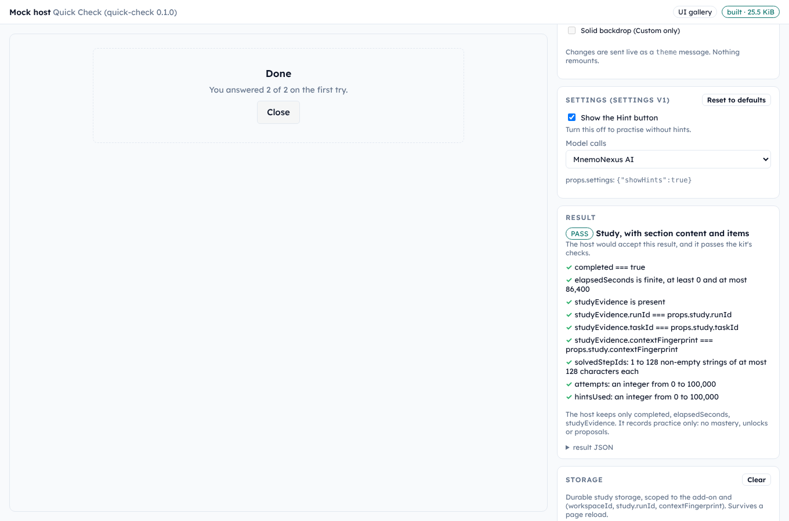

# MnemoNexus add-on kit

Build add-ons for [MnemoNexus](https://github.com/mnemonexus),
a desktop study app. An add-on is a small web app (a quiz, a lab simulation, a
study exercise) that runs inside the app in a locked-down frame called a
**sandbox**. You ship it as one `.mnxpack` file.

With this kit you can build and test an add-on without the app: a **mock host**
stands in for it. The **checker** validates the manifest, scans the bundle and
runs browser scenarios.



## Quick start

You need [Bun](https://bun.sh) (1.4.2 or later), Git, and
[Node.js](https://nodejs.org) 18 or later (`check` uses it to drive a browser).

```sh
bun install                 # 1. install the kit
bun run new my-quiz         # 2. copy the starter add-on to addons/my-quiz
bun run dev my-quiz         # 3. open the mock host; edit and save to reload
bun run check my-quiz       # 4. manifest, build, sandbox scan, headless run
bun run pack my-quiz        # 5. write addons/my-quiz/dist/my-quiz-0.1.0.mnxpack
```

For a **learning add-on**, one that prepares tasks from the lecture the user is
reading, start with `bun run new my-process --learning`. It copies
[Process Builder](addons/process-builder/), and the other four commands are the
same.

The starter is styled with the **UI library** (`@mnemonexus/addon-ui`), so it
looks like part of MnemoNexus in every theme the user picks. Add
`--screenshots` to step 4 to save it in light and dark, square and round,
lines and shadows, and to fail any text that is hard to read. If you prefer
Tailwind, the kit compiles it with a MnemoNexus preset (GUIDE.md section 10).

**Porting an existing project?** Keep its `package.json`, install its
dependencies in its folder, and the kit builds it: React and other libraries,
Tailwind 3, Sass, CSS modules. GUIDE.md section 20 covers what the sandbox
needs changed, and [`examples/ketcher-editor`](examples/ketcher-editor/)
ports Ketcher, an open-source chemistry editor, end to end.

Step 4 runs your add-on in a headless browser. The first time, you may need
`bunx playwright install chromium`. If no browser can start, `check` says the
add-on was "not run" and fails; `--no-browser` accepts a build-and-scan-only
check on purpose. If `bun install` has trouble with your network, `npm install`
works too.

## Install it in the app

In MnemoNexus, open **Add-ons → Install from file** and pick the `.mnxpack`
from `addons/<id>/dist/`. The app checks the pack again before it installs it.

## What's here

| Folder | What it is |
|---|---|
| [`templates/experience/`](templates/experience/) | The starter add-on that `new` copies. A working, commented example. |
| [`ui/`](ui/) | `@mnemonexus/addon-ui`: components that look like part of MnemoNexus, a Tailwind preset, and the [UI gallery](ui/gallery/). |
| [`mock-host/`](mock-host/) | The stand-in for the app that `dev` and `check` use. |
| [`tools/`](tools/) | The `mnx` command-line tool behind `new`, `dev`, `check`, `pack`, `sign` and `verify`. |
| [`sdk/`](sdk/) | `@mnemonexus/addon-sdk`: types, `getExperienceHost`, `buildPack`, the manifest and result validators, `defineAddon` for learning add-ons, and preview signing. |
| [`addons/`](addons/) | Real add-ons, one folder each. [`process-builder`](addons/process-builder/) is the learning add-on that `new --learning` copies. |
| [`examples/reference-addon/`](examples/reference-addon/) | The smallest working add-on. |
| [`examples/tailwind-flashcards/`](examples/tailwind-flashcards/) | An add-on styled with Tailwind and the MnemoNexus preset. |
| [`examples/legacy-styles/`](examples/legacy-styles/) | An add-on styled the way older projects are: Tailwind 3 with its own config, and Sass. |
| [`examples/ketcher-editor/`](examples/ketcher-editor/) | Ketcher, an open-source chemistry editor, ported from npm. It has its own dependencies: `npm install --prefix examples/ketcher-editor`. |
| [`reference/`](reference/) | Exact copies of the app's sandbox frame and stylesheet. Read-only. |
| [`docs/`](docs/) | The host contract and mock-host compatibility notes. |

## Read next

- [`GUIDE.md`](GUIDE.md): how add-ons work, from permissions to publishing.
- [`docs/HOST_CONTRACT.md`](docs/HOST_CONTRACT.md): exactly what the app does. The source of truth.
- [`docs/HOST_GAPS.md`](docs/HOST_GAPS.md): compatibility notes and mock-host limits.
- [`CONTRIBUTING.md`](CONTRIBUTING.md): development and validation requirements.
- [`PROMPT.md`](PROMPT.md): one prompt to paste into a chat AI that cannot see this repository.

## All commands

```sh
bun run new <id> [--label "My Add-on"]   # copy the starter to addons/<id>
bun run new <id> --learning              # start a learning add-on from Process Builder
bun run dev <id> [--port 4173]           # mock host with live reload
bun run check <id>                       # check one add-on
bun run check --all [--screenshots]      # check every add-on, example, template and the UI gallery
bun run check <id> --no-browser          # build and scan only (never in CI)
bun run pack <id>                        # build the .mnxpack
bun test                                 # the kit's own unit tests
bun run ui                               # after editing ui/src/addon-ui.css
bun run sign <pack> --key <path>         # PREVIEW: sign a pack (see GUIDE.md)
bun run verify <pack> --pub <path>       # PREVIEW: check a pack and its signature
```

MIT licensed.
